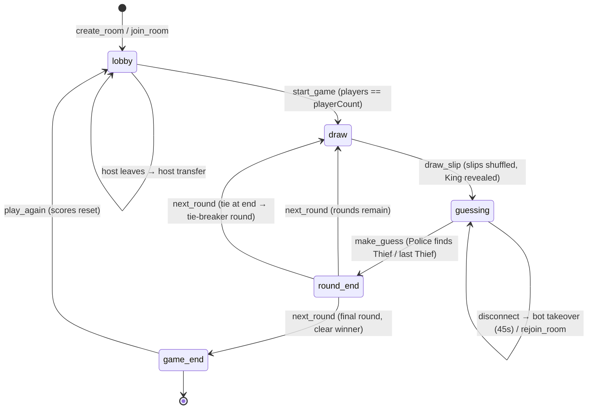

# Game State Diagram — Raja Rani Mantri Chor Sipahi

## State machine



Phases in code (`server/game.js`, `phase` field):

| Phase | What the player sees | What can happen |
|---|---|---|
| `lobby` | Room code, player list, settings (count, rounds, house rules, points, role names) | join / leave, add bots, change settings, start |
| `draw` | Slips shuffling animation (client-side, ~900 ms) | — (transient; server moves straight to `guessing`) |
| `guessing` | Chain progress, own slip, face-down table, active guesser highlighted | `make_guess` only from the current guesser |
| `round-end` | All roles + points revealed, leaderboard | `next_round` (host / any player in solo) |
| `game-end` | Winner, confetti, full score table | `play_again` → back to `lobby` |

## Events

### Client → Server (Socket.IO, `server/server.js`)

| Event | Payload | Server action |
|---|---|---|
| `create_room` | `{ name, avatar, settings }` | `createGame()` + `addPlayer()` (creator is host); returns `{ roomCode, playerId }` |
| `join_room` | `{ roomCode, name, avatar }` | `addPlayer()` if lobby + not full; else error |
| `rejoin_room` | `{ roomCode, playerId }` | Restore seat + role, `connected=true`, cancel bot takeover |
| `add_bots` | — | `fillWithBots()` up to `playerCount` |
| `update_settings` | `{ settings }` | `validateSettings()`; lobby only; trims players if count shrank |
| `start_game` | — | Needs `players == playerCount`; `startRound()`; emits `draw_slip` |
| `make_guess` | `{ targetId }` | Guarded by `guessLock`; `makeGuess()`; emits `guess_result` (+ `round_end` if the Thief was found) |
| `next_round` | — | `advanceAfterRound()` → `startRound()` / `game_end` |
| `play_again` | — | Scores reset, `phase='lobby'` |
| `chat` | `{ text, emoji }` | Broadcast to the room (text capped at 200 chars) |
| `disconnect` | — | Mark disconnected, hold seat, host transfer, bot takeover timer (45 s) |

### Server → Client

| Event | Payload | Notes |
|---|---|---|
| `state` | `getPublicState(game, viewerId)` | **Per-player.** Contains only the viewer's own role + revealed roles. Hidden roles are `null` — cheating via network/client inspection is impossible. |
| `draw_slip` | `{ round, tieBreaker? }` | Start the shuffle animation |
| `guess_result` | `{ ok, correct, swapped?, revealedRole?, nextGuesserId, nextTargetRoleId, roundEnded? }` | Drives the correct / swap animation |
| `round_end` | `getRoundSummary(game)` | All roles + points for the round |
| `game_end` | `{ winners, scores }` | Final screen + confetti |
| `chat` | `{ name, avatar, text?, emoji?, system?, at }` | Chat / emoji / system messages |
| `lobby-count` | `{ players }` | Lobby size updates |

## The guessing chain, precisely

```
King → Queen → Minister → Commander → Judge → Doctor → Merchant → Farmer → Police → Thief
(only the roles in play for N players; Police/Thief are always last)
```

- **Correct guess:** the target's role is revealed to everyone and that
  player becomes the next guesser, hunting the next role in the chain.
- **Wrong guess:** the guesser and the wrongly-guessed player **swap
  slips**. The guessing *role* follows the slip, so the wrongly-guessed
  player — now holding the guessing role — becomes the active guesser and
  tries again for the same next role. The original guesser is hidden
  again with their new role. The wrong guess is logged/shown to everyone.
- **Two Thieves:** after the Police finds the first Thief, that Thief
  becomes the guesser and hunts the second Thief. The round ends only
  when both are found.

## Edge cases

| Case | Handling |
|---|---|
| Guessing yourself | Rejected: `You cannot guess yourself` |
| Guessing an already-revealed player | Rejected: `That player is already revealed` |
| Guessing out of turn | Rejected: `Not your turn to guess` (server checks `currentGuesserId`) |
| Double-tap / simultaneous guesses | Server `guessLock` (single-flight guard) + client `state.lock`; Socket.IO delivers per-socket in order, so the second guess is validated against the new state and rejected if no longer valid |
| Repeated wrong guesses | Allowed — each one swaps slips and adds to `wrongGuesses` (penalty, if on). Bots avoid immediately re-guessing the same player when another target exists |
| Player disconnects mid-round | Seat + role are held. `rejoin_room` with the same `playerId` restores them exactly. After 45 s a bot takes over the seat (`isBot=true`); a rejoin hands the seat back (`isBot=false`) |
| Host leaves | Host transfers to the next connected player (`removePlayer()` / disconnect handler) |
| Player-count change in lobby | `update_settings` re-validates; if the count shrank, extra players are trimmed (last-joined first); if it grew, the room waits for more joins / bots |
| Room fills / game already started | `addPlayer()` returns `Room is full` / `Game already started` |
| Tie at the end | `advanceAfterRound()` starts a tie-breaker round (max 3); after that, tied players are joint winners |
| Custom points table | Validated per room; Thief is forced to 0 even if a custom table says otherwise; round points are clamped at ≥ 0 after the wrong-guess penalty |
| Two Thieves with < 8 players | Rejected at validation (`validateSettings` / `getRolesForPlayerCount`) |
| Bot as King / guesser | Bots act after a 1.1–2 s delay (`maybeBotTurn`), picking a random eligible target — same `makeGuess()` path as humans, so bot games obey the same rules |
| Empty room | Deleted after 10 minutes of no connected players |
